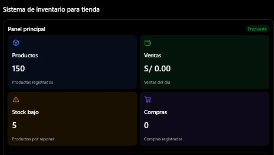
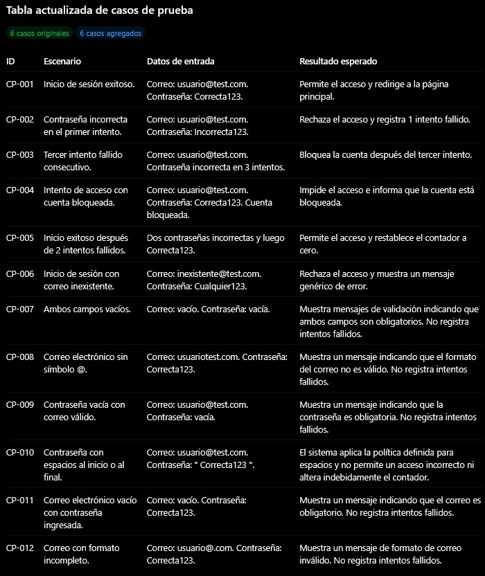

# Bitacora de tecnicas avanzadas

Laboratorio 07: Tecnicas Avanzadas de Prompting.
Herramienta de IA usada: (ChatGPT)

## Ejercicio 2: Zero-shot, one-shot y few-shot

| Tipo | Aciertos (de 5) | Formato de la respuesta | Todas con el mismo formato (Si/No) |
|------|-----------------|-------------------------|------------------------------------|
| Zero-shot | 5| Tabulacion con valores **positivo**, **neutral** y **negativo**| Si|
| One-shot | 5| Lista numerada con valores **positivo**, **neutral** y **negativo**| Si|
| Few-shot | 5| Asignacion con valores **positivo**, **neutral** y **negativo**| Si|

## Ejercicio 3: Chain of Thought

| Pedido | Respuesta de la IA | Muestra los pasos (Si/No) | Correcta (Si/No) |
|--------|--------------------|---------------------------|------------------|
| Directo | 318.60| No| Si|
| Paso a paso | La respuestase compone de 5 pasos y un resultado final:<br>1. Precio original de una unidad<br>2. Calcular el descuento del 25 %<br>3. Calcular el IGV del 18 %<br>4. Calcular el precio de las 3 unidades<br>5. Comprobación del resultado<br>Comprobamos mediante otra operación:<br>La comprobación coincide con el resultado anterior.| Si| No|

## Ejercicio 4: Role prompting

| Version | Vocabulario (sencillo/tecnico) | Usa ejemplos o codigo | A quien le sirve mas |
|---------|-------------------------------|-----------------------|----------------------|
| A. Sin rol | Sencillo| Si, usa el lenguaje **python**| Principiantes.|
| B. Rol docente | Tecnico| Si, usa el lenguaje **python**| Estudiantes de programacion.|
| C. Rol senior | Tecnico| Si, usa el lenguaje **java**| A un profesional con experiencia en programacion.|


## Ejercicio 5: Descomposicion

| Paso | Pedido de una sola vez | Pedido por pasos |
|---|---|---|
| 1| La IA propone un sistema mostrando un panel principal<br><br>Describe los modulos del sistema propuesto:<ul><li>Registro y edición de productos</li><li>Control de entradas y salidas</li><li>Registro de ventas</li><li>Registro de compras y proveedores</li><li>Reportes de inventario y ganancias</li><li>Historial de movimientos</li></ul><br>Finalmente solicita datos para construirlo:<ul><li>¿Donde quieres usarlo?</li><li>¿Que tipo de tienda tienes?</li><li>¿Cuantaas personas lo usaran?</li></ul>| La respuesta propone 5 requisitos:<ol><li>Gestión de productos</li><li>Control de stock</li><li>Gestión de proveedores</li><li>Registro de movimientos</li><li>Reportes y consultas</li></ol>Tambien propone Recomendaciones tecnologicas y <br>Un consejo. |
| 2|   | La IA propone diseñar 7 clases principales usando POO y atributos:<ol><li>Clase Producto</li><li>Clase Proveedor</li><li>Clase Movimiento</li><li>Clase Inventario</li></ol><p>La respuesta es inconsitente ya que solo muestra 5 clases de las 7 que supone realizar. |
| 3|   | Se propone los atributos, metodos y constructor.<br>Brinda una breve explicacion del codigo,<br>Ejemplo del uso de la clase,<br>Resultado esperado y<br>Una nota sebre la validacion del codigo para algunos metodos para valores negativos.<br>El codigo se compiló en un archivo con el nombre **Producto.java** y se obtuvo el archivo **Producto.class**. |
| 4|   | La IA confirma que el codigo esta correctamente estructurado. Seguido muestra mejoras concretas:<ol><li>Agregar validaciones a los metodos set</li><li>Incorporar un método para actualizar el stock</li><li>Agregar un método para verificar el stock mínimo</li></ol>Tambien incluye un Resumen de las mejoras y <br>Una conclusion. |

## Ejercicio 6: Prompt estructurado y autocritica

| Qué revisar |Cumple (Sí / No) |
|---|---|
| ¿Tiene las 4 columnas pedidas? | Si |
| ¿Incluye el bloqueo después de 3 intentos? |  Si |
| ¿Incluye casos con campos vacíos? | Si |
| ¿Indica qué casos agregó en la autocrítica? | Si:<br>CP-007,<br>CP-008,<br>CP-009,<br>CP-010,<br>CP-011 y<br>CP-012 |
| ¿Hay algún caso repetido o que no tenga sentido? | No |

### Promt estructurado

```text
<rol>Actua como analista de pruebas de software.</rol>
<contexto>Login web con correo y contrasena. La cuenta se bloquea
despues de 3 intentos fallidos.</contexto>
<tarea>Piensa paso a paso que puede fallar y escribe 6 casos de prueba.</tarea>
<formato>Tabla con las columnas: ID, escenario, datos de entrada,
resultado esperado.</formato>
```
### Autocritica
```text
Revisa tu tabla: faltan casos limite como campos vacios, correo sin @
o contrasena con espacios? Agrega los que falten e indica cuales agregaste.
```
### Tabla actualizada de casos de prueba

